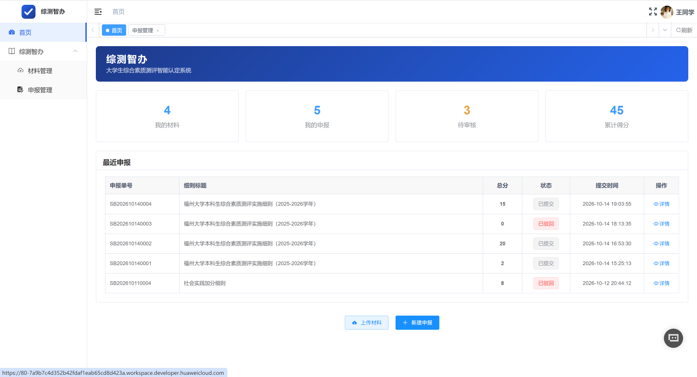
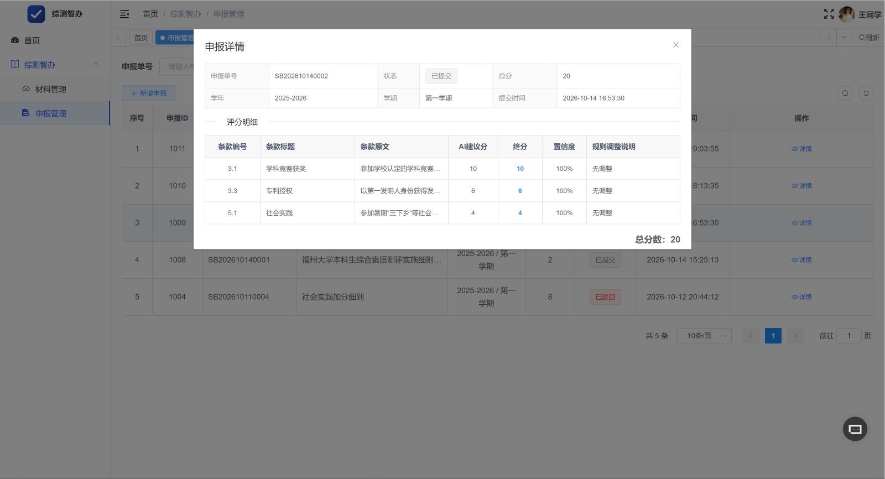
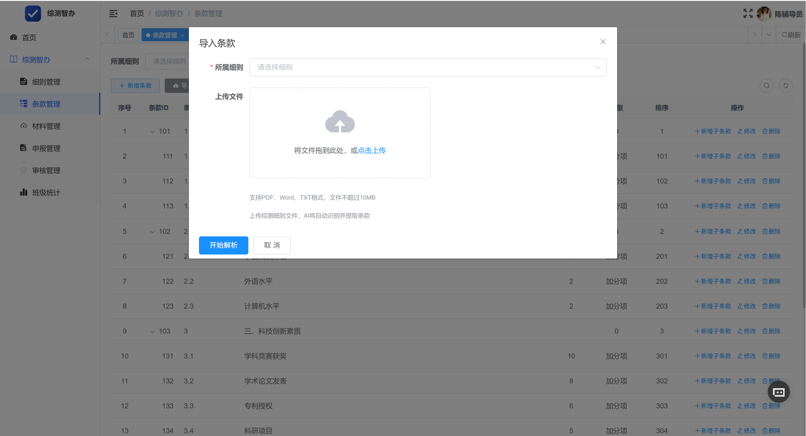
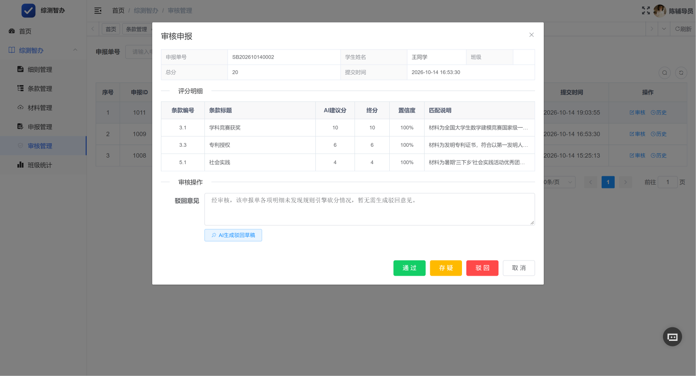

# 综测智办

> 大学生综合素质测评加分智能认定助手 —— 华为开发者大赛参赛项目

基于 RuoYi-Vue 二次开发，深度集成华为云 MaaS 大模型（qwen2.5-vl-72b），实现综测加分
「材料上传 → OCR 识别 → AI 条款匹配 → 规则引擎定分 → 审核归档」全流程自动化。

## 一、解决什么痛点

传统综测加分认定：辅导员人工收集材料、逐条比对细则、手动算分——一个班几百份材料耗时一周起，
标准不一、易出争议。本系统让大模型做"识别与匹配"，让规则引擎做"定分"，让证据链保证"可追溯"。

## 二、核心亮点

### 1. AI 只建议，规则引擎定分
AI 产出的每条分值必须携带完整证据链（条款编号 + 条款原文 + 置信度），最终分值由本地规则引擎
统一计算（cap 封顶 / mutex 互斥 / time_window 时间窗校验），大模型不直接决定分数。

### 2. 条款批量导入（AI 预填 + 人工确认）
上传整份综测细则（PDF/Word/TXT）→ 按章节分块调用大模型解析出「模块-加分项」两级树 →
人工在预览界面勾选修正 → 事务批量入库。AI 只预填，准确性由人工确认兜底。

### 3. OCR 全链路异步化
PDFBox 文本抽取 + VLM 图片识别双通道，材料上传后自动触发识别，失败可一键重试。

### 4. 三角色权限与服务端数据隔离
学生（材料+申报）、班委（班级统计）、辅导员（细则/条款/审核/规则引擎）。
学生仅能查看操作自己的数据、班委仅限本班，全部在服务端强制过滤 + 行级越权校验。

### 5. 班级统计纯 SQL 聚合
统计逻辑全部在 Mapper XML 聚合 SQL 中完成，无内存全量计算。

## 三、技术栈

| 层 | 技术 |
|---|---|
| 后端 | Spring Boot / Spring Security / MyBatis（RuoYi-Vue 3.8.x） |
| 前端 | Vue 2 / Element UI |
| 数据库 | MySQL 8 |
| AI | 华为云 MaaS（ModelArts Studio）qwen2.5-vl-72b，统一承担文本与 VLM 任务 |
| 文档解析 | Apache PDFBox / Apache POI |

## 四、项目结构

backend/   若依后端 + assess 综测业务模块
frontend/  若依前端 + 综测业务页面
docs/      设计文档
sql/       建表与菜单/演示数据脚本

## 五、快速开始

1. 创建数据库 `ry_cloud`，依次执行 `sql/` 下脚本：若依基础库 → assess_init.sql →
   assess_rule_menu.sql → assess_stats_supplement.sql → assess_demo_data.sql
2. 修改 `backend` 数据源配置，并配置 MaaS：
   assess:
     ai:
       enabled: true      # false 切换 Mock 实现，无 MaaS 也可完整演示
     maas:
       base-url: https://api.modelarts-maas.com/v1
       api-key: {..........}
       model: qwen2.5-vl-72b
3. 启动后端（RuoYiApplication）与前端（npm run dev）
4. 演示账号：admin（管理员）/ {TODO 学生账号} / {TODO 班委账号} / {TODO 辅导员账号}

## 六、演示流程
### 1.首页仪表盘

### 1.申报详情证据链

### 1.条款批量导入预览

### 1.审核三态与AI驳回草稿

## 七、AI 可靠性设计

- 严格 JSON Schema 输出，空值 / 解析失败 / 越界值三级兜底
- assess.ai.enabled 开关，MaaS 不可用时自动降级 Mock
- 规则引擎时间窗校验取不到日期字段时跳过并记录提示，禁止静默清零分值
- 审核操作单事务原子完成状态变更与记录插入

## 八、开源致谢

基于 [RuoYi-Vue](https://gitee.com/y_project/RuoYi-Vue) （MIT License）二次开发，保留原版权声明。